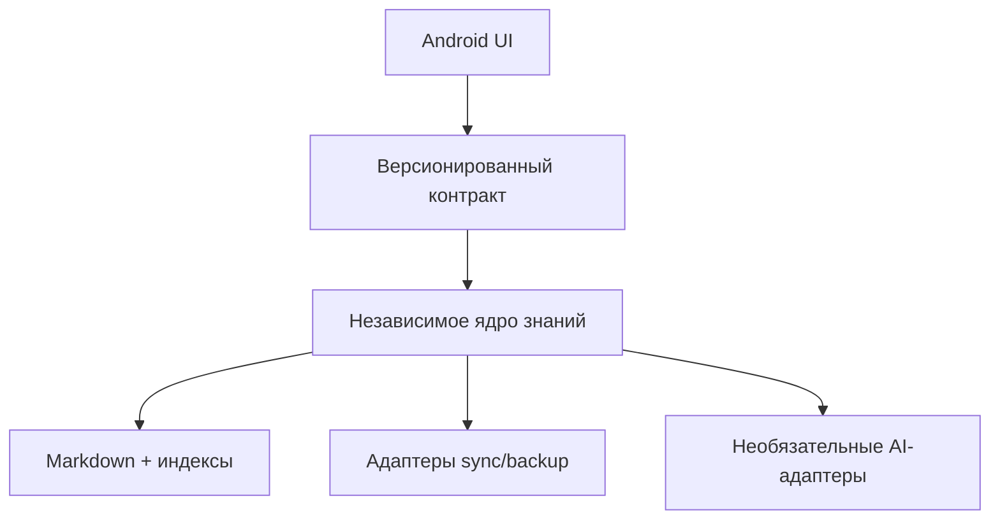

# DP Knowledge System — подтверждённые требования к продукту

**Утверждены владельцем 2026-11-18.** Это целевое ТЗ, а не список
реализованных возможностей. Статус работ — в [DEVELOPMENT_PLAN.md](DEVELOPMENT_PLAN.md),
технические риски — в [TECHNICAL_DEBT.md](TECHNICAL_DEBT.md).

## Назначение

Персональный интеллектуальный ассистент для локальной Markdown-библиотеки:
понятная работа с источниками, поиском, сущностями, связями, противоречиями,
неопределённостями, историей решений и языковыми моделями. Приложение должно
по продуктивности заменить Obsidian в нужных пользователю сценариях, но
**не копирует Obsidian** и не обязано запускать его плагины или форматы UI.

## Архитектура — переносимое ядро, Android как первая оболочка

- Первая целевая платформа — **Android**. Сборки для других ОС могут
  повторно использовать ядро через стабильный контракт без Android SDK.
- Существующий `ksys` на Python остаётся эталоном детерминированного
  поведения. Использование Chaquopy в прототипе не должно заставлять
  переносить Android-зависимости в ядро; будущая упаковка/язык ядра —
  отдельное техническое решение с golden parity tests.
- Поддержка устаревших Android не является целью. `minSdk` можно поднять
  после анализа платформенных API; конкретная новая граница ещё не выбрана.
- Основная рабочая библиотека — **20 000 Markdown-заметок**. Первый импорт
  может быть долгим, но прогресс не должен блокировать интерфейс. Качество
  и потребление ресурсов измеряются, не объявляются без испытаний.

## Автоматическая интеллектуальная обработка

1. Автоматически и инкрементально обнаруживать, читать, классифицировать,
   индексировать заметки, строить связи, находить кандидатные противоречия,
   неоднозначности, пробелы и возможные уточнения. Отмечать неполный охват.
2. **Безопасные операции** — работа с индексами/кэшем, расчётами, списками
   предложений и отчётами — могут исполняться автоматически без изменения
   оригинала.
3. **Рискованные операции** — редактирование исходника, изменение метаданных
   в нём, перенос, переименование, удаление — требуют разрешения по
   проверяемому сценарию с diff, source hash, резервной копией и rollback.
4. Система поддерживает индивидуальное и **пакетное** принятие знаний,
   а также автоматические решения по заранее одобренным строгим правилам:
   версия источника, однозначность, схема, противоречия, provenance,
   допустимые предикаты и границы полномочий. Каждое решение объяснимо,
   воспроизводимо и отзываемо. Только высокий LLM score недостаточен.
5. Пользователь управляет источниками, версиями, списком кандидатов,
   активными правилами и изменениями. Никакая модель не становится
   независимым авторитетом по умолчанию.

## LLM и поиск

- Поддержать **локальную модель на Android**, **модель на ПК в LAN/Tailscale**
  и **облачный совместимый API**. Основной ориентир — локальный inference,
  но его наличие **не является требованием для запуска приложения**.
- Полноценная работа с заметками, FTS, формальным ядром и аудитом — offline,
  без установки/скачивания модели. При недостатке RAM или недоступности
  модели доступен корректный возврат в режим без ИИ.
- Гибридное ранжирование FTS + эмбеддинги; точные привязки к оригинальным
  фрагментам, учёт контекста и времени; LLM ответ отдельно помечен как
  гипотеза/совет, пока доказательства не проверены.
- Текст заметок не отправляется сетевому провайдеру без осмысленного
  разрешения. Ключи API хранятся под защитой Android Keystore, а перенос
  возможен только в отдельном парольном шифрованном экспорте.

## Файлы, сохранность и переносимость

- Markdown — первичный пользовательский источник, а не база приложения;
  сторонние инструменты могут редактировать и синхронизировать эти файлы.
- Оригинальные версии заметок архивируются в **ZIP внутри приложения**
  до рискованных преобразований. Для переживания удаления приложения есть
  независимый переносимый архив и внешнее хранилище.
- **Полный импорт/экспорт**: заметки, журнал решений, правила и политики,
  метаданные и настройки, подключения и экспортируемые секреты. Индексы
  восстанавливаются либо включаются в расширенный слепок по выбору.
- **Автобэкап ежедневно по умолчанию** с настройкой интервала, места,
  размера и retention. Внешний/облачный бэкап включается пользователем.
- Поддерживать внешнюю синхронизацию (включая Syncthing) и собственную;
  Google Drive — один из опциональных сервисов копирования. Без потерь
  при параллельных правках и разветвлённых журналах.
- Дизайн: [SYNC_BACKUP_ARCHITECTURE.md](SYNC_BACKUP_ARCHITECTURE.md).

## Интерфейс — новая система вместо текущей оболочки Markor

- Полноценная **собственная информационная архитектура**: библиотека,
  редактор, поиск/граф, аудит, решения, ассистент, фоновые процессы,
  синхронизация, резервные копии, настройки.
- Современные Android-компоненты, динамическая цветовая тема, светлый/тёмный
  режим, адаптация к экранам, читаемая типографика и доступность.
- Экономный рендеринг больших списков, списки с виртуализацией, ограничение
  нагрузки, невмешивающиеся индикаторы и возможность продолжать работу
  во время импорта/индексации.
- Наглядный прогресс с отменой/повтором, результаты diff, риски, причины
  пропусков, очередь ручного подтверждения и наблюдаемость фоновых заданий.
- Использовать проверенные компоненты и код Markor там, где это полезно,
  не сохранять старый UI ради совместимости. Указание оригинальных авторов,
  лицензий и модификаций обязательно.

## Совместимость и распространение

- Поддерживать **чтение и максимально сохранный импорт** конструкций
  Markdown из Obsidian, необходимых для качественного анализа. Не обещать
  совместимость с Canvas/Dataview/плагинами, если нет отдельного решения.
- Целевые каналы: **GitHub Releases и RuStore**; требования RuStore, Android,
  право на хранение файлов и модель подписи перепроверяются перед публикацией.
- Отдельно демонстрировать, что пререлиз установлен на физическом Android,
  его подпись/скачивание проверены и приватные данные не входят в артефакты.

## Порядок работ по решению владельца

После обязательных блокеров безопасности/QA приоритеты:

**A** точность семантики → **B** скорость на 20k → **C** современный UX →
**D** on-device AI → **E** собственная синхронизация → **F** расширенная
совместимость/Markdown. Зависимости, защищённость данных и корректное
резервирование могут обоснованно предшествовать любому пункту.
